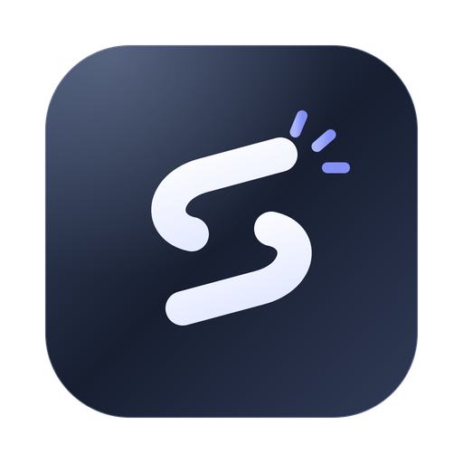
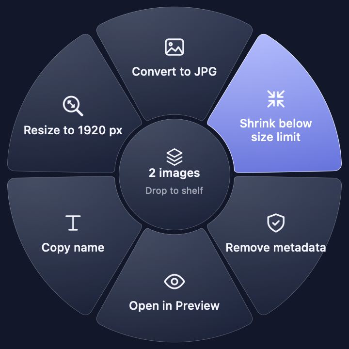
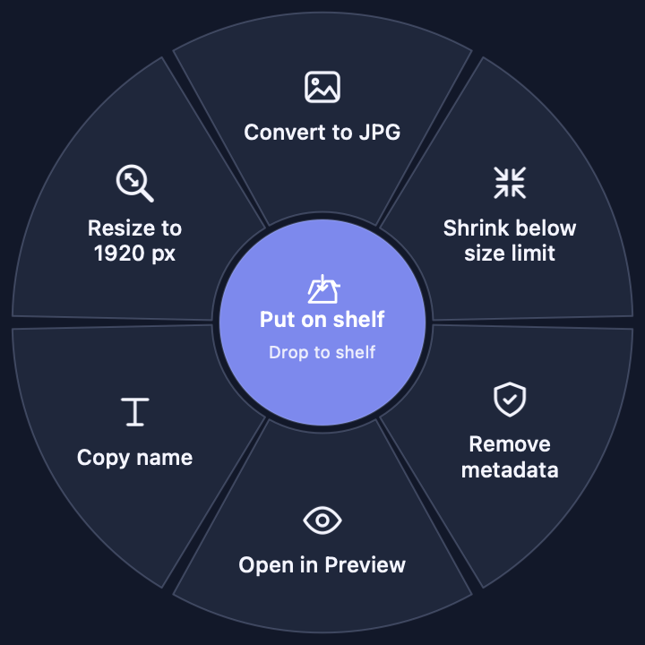
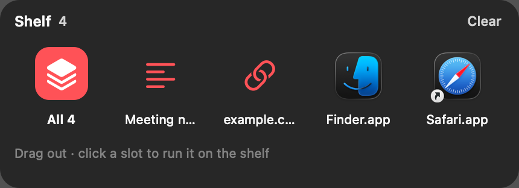
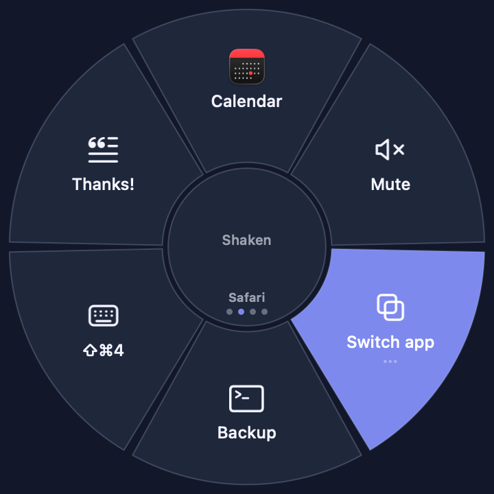

<p align="center">
  
</p>

<h1 align="center">Shaken</h1>

<p align="center">
  <strong>Shake mid-drag, pick a command, drag the result onward.</strong><br>
  A radial launcher and drag toolkit for the Mac menu bar.
</p>

<p align="center">
  <a href="https://shaken.noxhsxrk.com/download"></a>
  <a href="LICENSE"></a>
  
  
  
</p>

<p align="center">
  <a href="https://shaken.noxhsxrk.com/download"><strong>Download</strong></a> ·
  <a href="#a-short-walkthrough"><strong>Walkthrough</strong></a> ·
  <a href="#what-a-slot-can-do"><strong>Slot types</strong></a> ·
  <a href="#writing-a-command"><strong>Write a command</strong></a> ·
  <a href="#roadmap"><strong>Roadmap</strong></a>
</p>

<p align="center">
  Drag files, links and text · Convert and run commands mid-drag · Undo anything ·
  Apps, Shortcuts, scripts, snippets and keys on one wheel · A wheel per app
</p>

---

Shaken is a free, open-source menu-bar app for macOS. While you drag something (a photo, a PDF,
a link, some text), give the mouse a quick shake. A six-slot wheel opens under the pointer.
Drop on a slot and Shaken runs it: it converts the file, opens it in an app, copies it to a folder,
runs a Shortcut or a script. The result appears as a small chip that you can drag straight into
the next app.

Without dragging anything, the same wheel works as a launcher. Press a key and you get your apps,
snippets, keyboard shortcuts, system controls and workflows, all one flick away.

<p align="center">
  
</p>

- **Drag onward.** Results land in a chip under the pointer. Drag it into Finder, Safari, Chrome,
  Slack or Mail.
- **Always undoable.** Esc stops a running job and cleans up. The undo button moves results to
  the Trash. It never touches the originals, and leaves a result alone if you edited it afterwards.
- **Drag anything.** Files, folders, file promises (Photos, Mail, Safari images), links and text.
- **More than conversions.** Slots can hold apps, folders, websites, Apple Shortcuts, shell
  scripts, AppleScript, text snippets, key presses, system controls, multi-step workflows and an
  app switcher.
- **A wheel per app.** Safari can get one wheel and Figma another. Flip between wheels with ⌘← and ⌘→.
- **Write your own commands.** A folder with an `action.toml` and a short script gets the chip,
  cancel, undo and error messages for free. Share them as Git packs, and share whole wheels as files.

Requires macOS 13 or later. Free, MIT licensed.

---

## Contents

- [A short walkthrough](#a-short-walkthrough)
- [Install](#install)
- [Opening the wheel](#opening-the-wheel)
- [Controls](#controls)
- [What a slot can do](#what-a-slot-can-do)
- [The shelf](#the-shelf)
- [More wheels, per-app wheels, and sharing](#more-wheels-per-app-wheels-and-sharing)
- [Built-in commands](#built-in-commands)
- [Writing a command](#writing-a-command)
- [Command packs from Git](#command-packs-from-git)
- [Permissions](#permissions)
- [Updates and help](#updates-and-help)
- [How it works](#how-it-works)
- [Roadmap](#roadmap)

---

## A short walkthrough

Five short scenes that show the whole idea, the way a demo video would.

### Scene 1: a HEIC photo, and a form that only takes JPG

1. In Finder, start dragging `IMG_0412.HEIC` toward the upload form in your browser.
2. Halfway there, shake the mouse left and right two or three times. The wheel opens under the pointer.
3. Keep holding the button and slide onto **Convert to JPG**. The slot lights up. Let go.
4. A chip appears where you dropped it, with a spinner while it works. Then it shows
   `IMG_0412.jpg` and the size change, for example 3.1 MB → 1.2 MB.
5. Press on the chip and drag it into the form. The original HEIC is untouched.

<p align="center">
  
</p>

Changed your mind? Press the undo button on the chip and the JPG goes to the Trash.
Opened the wheel by accident? Just move out of it. It closes at once and your drag carries on
as if nothing happened.

### Scene 2: park it on the shelf for later

1. You find three screenshots you'll need in a minute, but the place they're going isn't open yet.
2. Drag them, shake, and drop them on the **middle** of the wheel ("Put on shelf").
3. Later, press **⌃⌥Space** anywhere. The wheel opens with the shelf underneath.
4. Drag a tile, or **All 3**, into Slack. Each item leaves the shelf once it's delivered.

<p align="center">
  
  
</p>

You can also click a slot while the shelf is up. Commands, apps, folders, Shortcuts and scripts
then act on everything on the shelf, for example to zip all of it at once.

### Scene 3: the wheel as a launcher

1. Press **⌃⌥Space** with nothing dragged. The wheel opens under the pointer.
2. Press **→** twice and **Return**, or press **3**, or just click. Calendar opens.
3. Other slots mute the sound, paste your email signature, press `⇧⌘4`, or run a backup script.

<p align="center">
  
</p>

### Scene 4: a different wheel in every app

1. In *Settings → Wheel*, choose **Add Wheel → Wheel for an App…** and pick Safari. Give it slots for
   *Reader mode* (keys `cmd+shift+r`), *Translate this page* (a Shortcut) and your bookmarks.
2. Back in Safari, press ⌃⌥Space. The Safari wheel opens instead of the main one.
3. Press **⌘←** or **⌘→**, or swipe sideways with two fingers, to flip to the main wheel, to your other app wheels, or to
   **Running apps**: a ring of the apps you used most recently. Arrow to one and press Return to switch.

The bottom of the centre shows which wheel you're on: its name, and one dot per wheel with the
current one highlighted.

### Scene 5: one slice, five steps

A **Workflow** slot runs up to twelve steps in order. A "Start work" slot might:

1. open Slack,
2. open the team board in the browser,
3. run the Shortcut that sets a Focus mode,
4. wait 1 second,
5. press `ctrl+opt+left` to snap the window into place.

Build it in *Settings → Wheel*, reorder steps with the arrows, and press **Run Now** to try it.

When something fails, the chip says what went wrong in plain words and stays until you close it:

<p align="center">
  
</p>

---

## Install

Download the latest DMG from [shaken.noxhsxrk.com/download](https://shaken.noxhsxrk.com/download), drag Shaken to Applications and open it. The Shaken icon appears in
the menu bar. There is no Dock icon. Opening Shaken again shows Settings.

The current builds aren't notarized by Apple yet, so the first time macOS says it can't check
Shaken for malware. Open *System Settings → Privacy & Security* and choose **Open Anyway**, or
run `xattr -dr com.apple.quarantine /Applications/Shaken.app` once.

To build from source you need Xcode installed, but you never have to open it:

```sh
./build.sh                    # build build/Shaken.app, quit the running copy, open the new one
./build.sh --no-open          # build only
scripts/test.sh               # run the test suite
```

---

The first time Shaken starts, a short welcome walks you through shaking, the keyboard and
permissions, with a sample photo to try it on. Reopen it any time from *Help › Show Welcome*.

## Opening the wheel

| How | What the wheel works on |
|---|---|
| Shake while dragging | What you're dragging |
| ⌃⌥Space, or any shortcut you record in *Settings → Gesture* | The shelf if it has anything, otherwise the clipboard |
| ⌥ + shake, with no button pressed | Same as the shortcut |
| Menu bar → *Open Wheel* | Same as the shortcut |

A shake without dragging and without ⌥ never opens the wheel, because macOS uses that gesture to
make the pointer bigger. The shake only counts while an item is being dragged, so moving windows
and selecting text never trigger it.

## Controls

**While dragging**

| Do this | What happens |
|---|---|
| Drop on a slot | Run it. A chip shows progress, then the result. |
| Drop on the centre | Put the item on the shelf. |
| Rest on a slot marked ••• | Open its submenu. Rest on the centre to go back. |
| Move out of the wheel | Close it. The drag carries on normally. |
| Shake while dragging the chip or a shelf tile | Open the wheel again to chain another command, for example shrink, then zip. |

**With the wheel open, nothing dragged**

| Key | What it does |
|---|---|
| ← → (or ↑ ↓) | Move around the wheel |
| Return or Space | Pick the highlighted slot |
| 1 – 6 | Pick that slot at once. Each slot shows its number (1 is the top, then clockwise) |
| Delete | Leave a submenu |
| ⌘← ⌘→ (or Tab, ⇧Tab) | Switch between the main wheel, your other wheels, app wheels and *Running apps* |
| Two-finger swipe sideways | The same, on a trackpad or Magic Mouse. The ring of slots turns with your fingers like a dial and the next wheel turns in; let go early and it springs back |
| Esc | Close |

These keys belong to Shaken only while the wheel is open.

**The chip**

| Do this | What happens |
|---|---|
| Drag it | Take the result or results into another app |
| Undo button | Move the results to the Trash |
| Esc | Cancel a running job, or close the chip |

---

## What a slot can do

Six fixed slots, so your hand learns where things are. Change them in *Settings → Wheel*
(drag one slot onto another to swap).

| Slot | Click it | Drop on it |
|---|---|---|
| **Suggested command** (default) | Runs on the shelf or clipboard | Filled with whatever fits what you're dragging |
| **Command** | Same, always the same command | Same |
| **App** | Opens or switches to the app | Opens the files or link in it |
| **Folder** | Opens it in Finder | Copies the files into it (undoable) |
| **File** | Opens the file | — |
| **Website** | Opens the page | `{query}` in the address becomes the dragged text or link |
| **Apple Shortcut** | Runs the Shortcut; its output lands in the chip | Runs it with the dragged items as input |
| **Shell script** | Runs the zsh code typed into the slot; files written to `$SHAKEN_OUTPUT` land in the chip | Files are `$1`, `$2`…; text is in `$SHAKEN_TEXT` |
| **AppleScript** | Runs the script typed into the slot | Files are passed to `on run argv` |
| **Text snippet** | Pastes the text where you're typing* | — |
| **Keyboard shortcut** | Presses keys such as `cmd+shift+4` in the front app* | — |
| **System control** | Volume, mute, brightness*, play/pause*, next and previous track*, screenshot*, Mission Control, screen saver, dark mode, display off, lock screen*, sleep | — |
| **Workflow** | Runs up to 12 steps in order: apps, links, files, folders, Shortcuts, scripts, snippets, keys, system controls and waits | — |
| **App switcher** | Opens a ring of your six most recent apps | Rest on it, then drop on an app to open the files there |
| **Submenu** | Opens six more slots, one level deep | Rest on it to open |
| **Empty** | — | — |

\* Types into other apps, so it needs Accessibility permission. See [Permissions](#permissions).

**Workflows** are edited as a column of cards. Drag a card to reorder it, press its play button to
try that one step, or **Run All**. A slot that isn't filled in yet keeps its type and shows as
disabled on the wheel until it's complete.

Snippets restore your previous clipboard afterwards. Keys can be written as `cmd+shift+4`,
`ctrl+opt+t`, `f5` or `⌃⌥T`. Every slot has a **Run Now** button in Settings so you can try it.

*Settings → Commands* reorders or hides suggested commands for each kind of item.
*Settings → Gesture* sets shake sensitivity, an optional key to hold, apps to ignore and the
keyboard shortcut.

---

## The shelf

The shelf is a place to park things between apps.

- **To add:** drag, shake, drop on the centre of the wheel.
- **To use:** open the wheel without dragging. The shelf appears underneath. Drag a tile, or
  *All*, into another app; a delivered item leaves the shelf. Or click a slot to act on the
  whole shelf.
- **To remove:** the × on a tile, *Clear* in the tray, or *Clear Shelf* in the menu bar.

Files stay where they are. The shelf only remembers them, and forgets files that were moved or
deleted. Things that aren't files yet (file promises from Photos, images from Safari) are saved
under `~/Library/Application Support/Shaken/Shelf` and cleaned up on the next launch once nothing
points to them.

When the shelf is empty, the wheel works on the clipboard. Commands that would only copy the
clipboard back to itself are left out, and empty suggestion slots become shortcuts to Downloads
and Desktop.

---

## More wheels, per-app wheels, and sharing

**More wheels.** In *Settings → Wheel*, **Add Wheel → Blank Wheel** adds an empty wheel you can
name and fill however you like ("Media", "Work", "Snippets"). Open the wheel without dragging and
flip to it with ⌘← / ⌘→ or a two-finger swipe. The arrows next to its name set the order, and you
can record a shortcut that opens the wheel straight on it.

**Per-app wheels.** **Add Wheel → Wheel for an App…** gives an app its own six slots. It
replaces the main wheel when that app is in front and you open the wheel without dragging.
Drags always use the main wheel, so your hand never has to relearn it. Press ⌘← or ⌘→ to reach
the other wheels; the dots in the centre show where you are.

**Sharing.** *Settings → Wheel → Share* exports the wheel you're editing as a `.shakenwheel`
file. It can also import one from a file or an https link. Before anything is imported, Shaken
lists every script, Shortcut, snippet and key press in it, so you can see exactly what it would
do. A wheel made for one app offers to install as that app's wheel.

**Gallery.** *Settings → Gallery* lists wheels and command packs shared by others, from
[`gallery/index.json`](gallery/index.json). It starts with Media, Screenshots, Web search and
System wheels. Adding one goes through the same review as any import. To share your own, see
[`gallery/README.md`](gallery/README.md).

**App switcher previews.** Turn on *Settings → Gesture → Show window previews* to see the
highlighted app's front window beside the wheel. It needs Screen Recording permission and
macOS 14 or later, and is off by default.

---

## Built-in commands

| Dragged | Suggested |
|---|---|
| One HEIC or PNG | Convert to JPG, Shrink below size limit, Remove metadata, Open in Preview, Copy name |
| One JPG | Shrink below size limit, Remove metadata, Make PDF, Open in Preview, Copy name |
| One PDF | Split pages, Open in Preview, Copy name, Compress PDF |
| Several items or a folder | Compress to ZIP, Merge into PDF (images and PDFs only), Copy name, Rename in bulk |
| Any image (further down the list) | Resize to 1920 px, 1080 px or 50%, Convert to AVIF, Convert to WebP (needs `brew install webp`) |
| A link | Open link, Copy link, Make QR code |
| Text | Save as .txt, Copy text |

**Where results go**

- Next to the original, under a free name (`photo.jpg`, `photo 2.jpg`, …). Nothing is ever overwritten.
- If there is no source folder (file promises, links, text), or the items come from different
  folders, results go to `~/Downloads`.
- *Rename in bulk* asks for a name and renames the files in place as "Name 01", "Name 02"…
  Undo puts the old names back.
- Work happens in a temporary folder. Files move into place only when every step succeeded, and
  the temporary folder is removed on error or cancel. You never get half a result.

---

## Writing a command

One folder is one command. Put it in `~/Library/Application Support/Shaken/Actions/`
(*Settings → Commands → Open Commands Folder*), then press *Reload*.

```toml
# ~/Library/Application Support/Shaken/Actions/web-ready/action.toml
name = "Web ready"
icon = "globe"                    # any SF Symbol
accepts = ["public.image"]        # UTIs, or shaken.link / shaken.text / shaken.any
requires = ["cwebp"]              # missing tools show an install hint instead of running
run = "./web-ready.sh"
```

The script gets the dragged files as arguments and writes its results into `$SHAKEN_OUTPUT`.
A non-zero exit code means it failed, and whatever it printed to stderr is shown in the chip.

```sh
#!/bin/sh
for f in "$@"; do
  cwebp -quiet -q 82 "$f" -o "$SHAKEN_OUTPUT/$(basename "${f%.*}").webp" || exit 1
done
```

| Key | Meaning |
|---|---|
| `name` | Required. Shown on the wheel. |
| `icon` | SF Symbol name. Default `bolt`. |
| `accepts` | Every dragged item must match one entry. Default: anything. |
| `single_accepts` | When exactly one item is dragged, match these instead (e.g. `["public.folder"]`). |
| `min`, `max` | How many items. Default 1 to unlimited. |
| `requires` | Command-line tools that must exist. Homebrew paths are searched too. |
| `install` | Custom install hint. Default `brew install <tools>`. |
| `run` | `./script` inside the folder, or an inline shell command (`"$@"` are the inputs). |
| `steps` | Instead of `run`: a pipeline where each step's output is the next step's input. |

Environment: `SHAKEN_OUTPUT` (write results here), `SHAKEN_KIND` (`files`, `link` or `text`),
`SHAKEN_ACTION_DIR`, and `SHAKEN_TEXT` for text. For links and text the value is also `$1`.

Built-in steps you can chain: `convert:jpg|png|heic|tiff`, `resize:<px>`, `shrink[:<KB>]`,
`strip-metadata`, `to-pdf`, `merge-pdf`, `split-pdf`, `zip`, `qr`, `save-text`. These can only
be the last step: `open-with:<bundle id>`, `copy-names`, `copy-text`, `open-url`, `reveal`.

```toml
steps = ["resize:1920", "strip-metadata", "./to-webp.sh"]
```

The built-in commands are written in this same format (see `Sources/ShakenCore/ActionRegistry.swift`),
so your commands can do everything they can. Three examples ship in [`Examples/`](Examples) and
are copied into your commands folder on first launch.

For a quick one-off, a **Shell script** slot on the wheel is often enough: no folder, no manifest.
Use a command when you want the chip, undo and file placement.

---

## Command packs from Git

*Settings → Packs*: paste a Git URL and press *Install*. A pack is a repository whose sub-folders
(or root) contain `action.toml`.

- Installing only downloads files (`git clone` with hooks and submodules disabled). Nothing runs.
- Before a pack command's first run, Shaken shows every file in it and asks. It stores the SHA-256
  of each approved file. If a single byte changes, or a file is added, it asks again.
- Scripts run as you and can read and change any file you can. Shaken can move and undo only
  what a script writes into `$SHAKEN_OUTPUT`, and the approval dialog says so.
- *Remove* deletes the pack and its approvals.

Commands in your own Actions folder are yours and run without asking.

---

## Permissions

| Feature | Needs |
|---|---|
| Shaking a drag, the wheel, chip, shelf, commands, apps, folders, websites, Shortcuts, scripts | Nothing |
| Text snippets, keyboard shortcuts; brightness, media keys, screenshot and lock screen | Accessibility, asked the first time you use one |
| The *Dark mode* system control | Permission to control System Events, asked once |
| Window previews in the app switcher (off by default) | Screen Recording, asked when you turn it on |

Shaken watches the mouse with a standard event monitor and reads the drag only after you shake.
Global keys use Carbon `RegisterEventHotKey`, which needs no permission.

---

## Updates and help

- **Updates.** *Help › Check for Updates* (or *Check Now* in Settings) installs a newer version
  straight away: it reads the list of releases from shaken.noxhsxrk.com, downloads the DMG, checks
  it against the release's SHA-256, replaces the app (the old copy goes to the Trash) and reopens Shaken. The daily
  background check asks first. Turn it off in *Settings → General*.
- **Something wrong?** *Help › Report a Problem* copies your version, setup and recent errors
  (no file names or contents) and opens a new issue. *Help › Copy Diagnostics* copies the same
  text without opening anything.
- **Accessibility.** The wheel works with VoiceOver, and follows Reduce Motion and Increase
  Contrast.
- **What changed.** See [`CHANGELOG.md`](CHANGELOG.md). Security reports: [`SECURITY.md`](SECURITY.md).

---

## How it works

```
Action registry ─┐
                 v
Gesture detector -> Drag reader -> Action resolver -> Wheel overlay -> Job runner -> Result chip
```

| Part | File | Notes |
|---|---|---|
| Gesture detector | `ShakenCore/ShakeDetector.swift` | Counts quick direction reversals per axis. Tested by replaying recorded pointer paths. |
| Drag reader | `Shaken/DragReader.swift` | Compares the drag pasteboard's `changeCount` at mouse-down and at the shake, so only real drags count. Receives file promises after the drop. |
| Action resolver | `ShakenCore/ActionResolver.swift` | Filters by type and count, applies per-kind order, lays out the wheel once per drag so slots never move. |
| Wheel overlay | `Shaken/Wheel.swift` | Non-activating `NSPanel` registered as a drop target. Other apps own the mouse during a drag, so it polls the button state. |
| Job runner | `ShakenCore/JobRunner.swift` | Runs Swift steps and scripts. Scripts get their own process group: cancel sends SIGTERM, then SIGKILL. |
| Result chip | `Shaken/Chip.swift` | A second panel that is an `NSDraggingSource` for the result files. |
| Shelf | `ShakenCore/Shelf.swift`, `Shaken/ShelfTray.swift` | Items kept by reference in a JSON file. |
| Slot actions | `ShakenCore/Shortcuts.swift`, `InlineScript.swift`, `KeyCombo.swift`, `SystemControl.swift`, `Shaken/Typing.swift` | Shortcuts through `/usr/bin/shortcuts`, scripts through zsh and `osascript`, keys through `CGEvent`. |
| Settings | `ShakenCore/Settings.swift`, `WheelPreset.swift` | Versioned `Codable` JSON with stable slot ids, validated on load, save and import. |
| Look | `Shaken/Brand.swift`, `Shaken/Wheel.swift`, `Resources/` | Glass surfaces, palette, glyphs, app icon and menu bar icon. Respects Reduce Transparency and Increase Contrast. |
| Gallery and updates | `ShakenCore/Gallery.swift`, `UpdateCheck.swift`, `Updater.swift`, `gallery/` | The gallery reads this repository; updates read shaken.noxhsxrk.com/releases.json and install in place. |
| Packs | `ShakenCore/PackManager.swift` | Clone, fingerprint, approve, update, remove. |

---

## Roadmap

**Next**

- Hand-test the wheel, chip, shelf tray and swipe on real Macs, using the release checklist in
  [`docs/CHECKLIST.md`](docs/CHECKLIST.md)
- Tune the shake detector with real mouse and trackpad recordings. The current test traces are
  synthetic.
- A signed and notarized DMG on Releases, and a first public release

**Later**

- More command packs in the gallery, and a way to rate them
- Rename in bulk with patterns (dates, counters in other positions)
- Video and audio results in the chip shown with a preview
- Window previews for macOS 13

**Done since the first release:** gallery, window previews, visual workflow editor, WebP and AVIF,
resize presets, PDF compression, bulk rename, Shortcut and script results in the chip, and
chaining commands from the chip.

**Not planned**

- Windows or Linux versions
- Cloud services or accounts. Everything runs on your Mac.
- Video and Office conversion built in. Call tools you already have from a command instead.

## License

MIT
