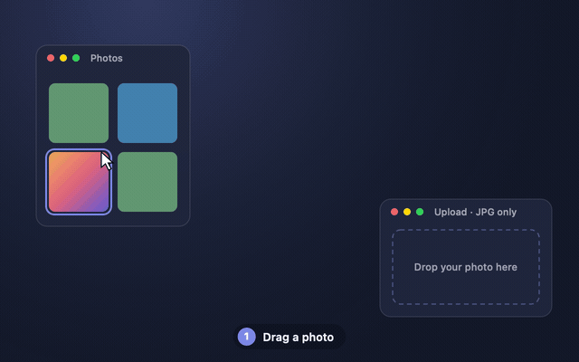
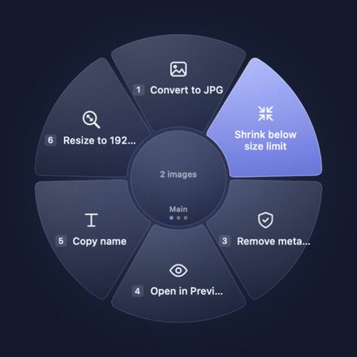

<p align="center">
  
</p>

<h1 align="center">Shaken</h1>

<p align="center">
  <strong>A little shake. A lot less work.</strong><br>
  A radial launcher and drag toolkit for the Mac menu bar.
</p>

<p align="center">
  <a href="https://shaken.noxhsxrk.com/download"></a>
  <a href="LICENSE"></a>
  
</p>

<p align="center">
  <a href="https://shaken.noxhsxrk.com/download"><strong>Download</strong></a> ·
  <a href="#how-it-works"><strong>How it works</strong></a> ·
  <a href="#writing-a-command"><strong>Write a command</strong></a> ·
  <a href="#install"><strong>Install</strong></a>
</p>

Shaken is a free, open-source menu-bar app for macOS. While you drag something (a photo, a PDF, a link,
some text), give the mouse a quick shake. A six-slot wheel opens under the pointer. Drop on a slot and
Shaken converts the file, opens it in an app, copies it to a folder, or runs a Shortcut or script. The
result appears as a chip you can drag straight into the next app.

<p align="center">
  
  <br>
  <sub>Drag a HEIC photo, shake, drop on <em>Convert to JPG</em>, then drag the JPG into the form.</sub>
</p>

## Features

- **Drag onward.** Results land in a chip under the pointer. Drag it into Finder, Safari, Slack or Mail.
- **Always undoable.** Esc cancels a running job. Undo moves results to the Trash and never touches originals.
- **More than conversions.** Slots can hold apps, folders, websites, Shortcuts, shell scripts, AppleScript,
  text snippets, key presses, system controls, multi-step workflows and an app switcher.
- **A wheel per app.** Safari gets one wheel, Figma another. Flip between wheels with ⌘← and ⌘→.
- **A shelf.** Park files on the centre of the wheel and drop them somewhere else later.
- **Launcher mode.** Press ⌃⌥Space with nothing dragged and the same wheel opens for apps, snippets and keys.
- **Extensible.** Write your own commands, share them as Git packs, and share whole wheels as files.

<p align="center">
  
</p>

## Install

With [Homebrew](https://brew.sh):

```sh
brew install --cask noxhsxrk/nox/shaken
```

Or download the DMG from [shaken.noxhsxrk.com/download](https://shaken.noxhsxrk.com/download), drag Shaken
to Applications and open it. It lives in the menu bar, with no Dock icon.

> [!NOTE]
> Current builds aren't notarized yet. From the DMG, macOS may warn on first launch: choose **Open Anyway**
> in *System Settings → Privacy & Security*, or run `xattr -dr com.apple.quarantine /Applications/Shaken.app`.
> Homebrew installs open straight away.

To build from source you need Xcode installed, but you never have to open it:

```sh
./build.sh             # build build/Shaken.app and open it
./build.sh --no-open   # build only
scripts/test.sh        # run the tests
```

## How it works

**Open the wheel**

| How | Works on |
|---|---|
| Shake while dragging | What you're dragging |
| ⌃⌥Space (rebind in *Settings → Gesture*), or menu bar → *Open Wheel* | The shelf if it has items, otherwise the clipboard |

**While dragging:** drop on a slot to run it, drop on the centre to put the item on the shelf, or move out
of the wheel to close it and carry on dragging.

**Wheel open, nothing dragged:** arrows move, Return picks, `1`–`6` pick a slot directly, ⌘←/⌘→ (or a
two-finger swipe) switch wheels, Esc closes.

### Slot types

Change slots in *Settings → Wheel*. Each has a **Run Now** button for testing.

| Slot | Click | Drop on it |
|---|---|---|
| Command | Runs on the shelf or clipboard | Runs on the dragged items |
| App / Folder / Website | Opens it | Opens the items in it, copies them in, or fills `{query}` |
| Apple Shortcut | Runs it | Passes the items as input |
| Shell script / AppleScript | Runs the code in the slot | Items arrive as arguments |
| Text snippet, Keyboard shortcut | Pastes text or presses keys | — |
| System control | Volume, brightness, media keys, screenshot, dark mode, lock screen and more | — |
| Workflow | Runs up to 12 steps in order | — |
| App switcher, Submenu | Opens a ring of recent apps or six more slots | — |

### Built-in commands

Shaken suggests commands based on what you drag:

- **Images:** convert (JPG, PNG, HEIC, AVIF, WebP), shrink, resize, rotate, remove metadata, remove
  background, extract text, make a PDF.
- **PDFs:** split, merge, compress.
- **Videos:** compress to 720p MP4, extract audio.
- **Any file:** ZIP, bulk rename with patterns, copy path, copy SHA-256.
- **Links and text:** open, copy, make a QR code, download, save as `.txt`.

Results are written next to the original under a free name, or to `~/Downloads` when there is no source
folder. Work happens in a temporary folder and files move into place only when every step succeeded, so you
never get a half result.

## Writing a command

One folder is one command. Put it in `~/Library/Application Support/Shaken/Actions/` (or use
*Settings → Commands → Open Commands Folder*) and press *Reload*.

```toml
# Actions/web-ready/action.toml
name = "Web ready"
icon = "globe"                    # any SF Symbol
accepts = ["public.image"]        # UTIs, or shaken.link / shaken.text / shaken.any
requires = ["cwebp"]              # missing tools show an install hint
run = "./web-ready.sh"
```

```sh
#!/bin/sh
for f in "$@"; do
  cwebp -quiet -q 82 "$f" -o "$SHAKEN_OUTPUT/$(basename "${f%.*}").webp" || exit 1
done
```

The script receives the dragged files as arguments and writes results into `$SHAKEN_OUTPUT`. A non-zero exit
shows stderr in the chip. You can also chain built-in steps with `steps = ["resize:1920", "strip-metadata", "zip"]`.
More examples are in [`Examples/`](Examples).

### Command packs and wheels

Install a Git repository of commands from *Settings → Packs*. Installing only downloads files; before a
pack command first runs, Shaken shows every file and asks, and it asks again if anything changes.

Wheels export as `.shakenwheel` files, and the *Gallery* in Settings lists ready-made ones
([`gallery/`](gallery/README.md)). Imports always list every script, Shortcut and key press first.

> [!WARNING]
> Pack and wheel scripts run as you and can read and change any file you can. Only install ones you trust.

## Permissions

Most features need nothing. Text snippets, key presses, brightness, media keys, screenshot and lock screen
need **Accessibility**, asked the first time you use one. Window previews in the app switcher (off by
default) need **Screen Recording**. Shaken reads a drag only after you shake, and the global shortcut needs
no permission.

## More

- Something wrong? *Help → Report a Problem* copies diagnostics (no file names or contents) into a new issue.
- Release checks: [`docs/CHECKLIST.md`](docs/CHECKLIST.md). Security reports: [`SECURITY.md`](SECURITY.md).
